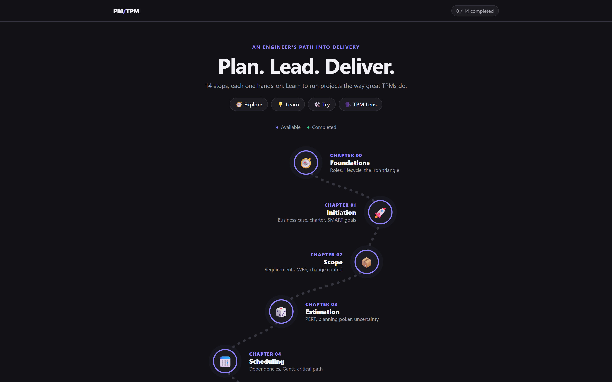

<div align="center">

# 🧭 PM/TPM

**Plan. Lead. Deliver.**

A hands-on journey into project management for engineers moving into technical project management.

🌐 **Live:** [explore-project-management.netlify.app](https://explore-project-management.netlify.app/)



</div>

## How it works

Every chapter follows the same path:

🧭 **Explore** → 💡 **Learn** → 🛠️ **Try** → 🗣️ **TPM Lens**

Interactive demos, short bullets, no walls of text.

## Chapters

| 📐 Plan the work | 🚀 Lead & deliver |
|---|---|
| 00 · [Foundations](chapters/00-foundations.html) | 07 · [Budget & Tracking](chapters/07-budget-tracking.html) |
| 01 · [Initiation](chapters/01-initiation.html) | 08 · [Methodologies](chapters/08-methodologies.html) |
| 02 · [Scope](chapters/02-scope.html) | 09 · [Stakeholder Communication](chapters/09-stakeholder-communication.html) |
| 03 · [Estimation](chapters/03-estimation.html) | 10 · [Hard Conversations](chapters/10-hard-conversations.html) |
| 04 · [Scheduling](chapters/04-scheduling.html) | 11 · [The "T" in TPM](chapters/11-technical-pm.html) |
| 05 · [Team & Resources](chapters/05-team-resources.html) | 12 · [Delivery & Closure](chapters/12-delivery-closure.html) |
| 06 · [Risk](chapters/06-risk.html) | 13 · [Capstone](chapters/13-capstone.html) |

## Run it

Plain HTML, CSS and JavaScript. No install, no build.

**1. Get the code**

```bash
git clone https://github.com/proatik/explore-project-management.git
cd explore-project-management
```

**2. Start a local server** (pick one)

- **VS Code:** install the *Live Server* extension → right-click `index.html` → **Open with Live Server**
- **Node:** `npx serve .`
- **Python:** `python -m http.server 5500`

**3. Open it in your browser**

Go to the address your server shows (e.g. `http://localhost:5500`) and start from the journey map. Your progress is saved in the browser.
